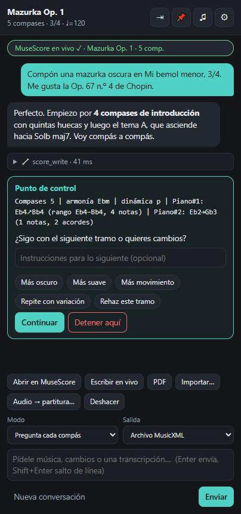

# ComposeAnything

**Un copiloto de IA pegado a MuseScore.** Un panel de chat (como un *devchat*) que va al lado de MuseScore y un servidor **MCP** que compone, edita y transcribe música en tu partitura. Funciona con cualquier IA compatible con OpenAI (OpenAI, OpenRouter, Ollama, LM Studio, Claude por su endpoint compatible…) y con Claude Desktop / Claude Code a través de MCP.

*English in one line: a docked AI chat panel + MCP server for MuseScore that writes, edits, lints and transcribes scores; any OpenAI-compatible model or any MCP client.*



## Qué hace

- **Compone en vivo o en lote.** Tú eliges el ritmo de trabajo: que **pregunte tras cada compás** con un resumen de cómo va, cada 4 compases, cada sección, o que haga **toda la obra solo**. Los puntos de control los impone el código, no el prompt, así que funcionan igual con modelos pequeños.
- **Escribe sin duplicar.** Cada escritura es atómica e idempotente: reescribir un compás lo reemplaza; si algo no es válido no se escribe nada. Hay deshacer/rehacer.
- **Edita partituras existentes.** Importa `.mscz`, `.mscx`, `.mxl`, MusicXML o MIDI, pídele cambios y vuelve a abrirla en MuseScore.
- **Coros SATB.** Plantillas abierta y cerrada, reparto de letra por sílabas y revisión de reglas (tesituras, cruces de voces, quintas y octavas paralelas).
- **Transcribe audio.** Melodías desde WAV (o MP3/M4A con ffmpeg) y MIDI, con estimación de tempo y tonalidad. Polifonía opcional con `basic-pitch`.
- **Conoce tus gustos.** Un perfil con las obras y estilos que te gustan que se inyecta en cada conversación, y que la IA puede ampliar si le cuentas qué te gusta.
- **Pegada a MuseScore.** Botón «Pegar»: MuseScore a la izquierda, la app a la derecha (Windows).

## Instalación rápida (Windows)

1. Consigue `ComposeAnything-Setup-<versión>.exe`: genéralo con `npm run dist` (queda en `dist/`) o, cuando haya una etiqueta `v*`, descárgalo de [Releases](https://github.com/PentaVM/ComposeAnything/releases) (lo compila y adjunta el CI).
2. Ejecútalo. Se instala **para tu usuario, sin pedir administrador ni preguntas**, crea los accesos directos (escritorio y menú Inicio) y abre la app.
3. En el primer arranque la app **copia sola el plugin** a `Documentos\MuseScore4\Plugins` y te muestra el único paso manual que queda: en MuseScore, *Plugins → Gestionar plugins… → ComposeAnything*, y luego *Plugins → ComposeAnything* con una partitura abierta.
4. En ⚙ eliges tu IA. Si prefieres usar Claude Desktop, el botón de conexión (pastilla de arriba) tiene **Añadir a Claude Desktop**; reinicia Claude Desktop después.

No necesitas Node ni Python instalados. El instalador **no está firmado**, así que Windows SmartScreen mostrará «Windows protegió su PC»: pulsa *Más información → Ejecutar de todas formas*. Para desinstalar: *Configuración → Aplicaciones* (tus obras y ajustes en `~/.composeanything` se conservan; el plugin copiado, `Documentos\MuseScore4\Plugins\composeanything.qml`, se borra a mano).

## Desde el código fuente

Necesitas **Node 20+** y **MuseScore Studio 4** reciente (probado con 4.7.6; el plugin usa la API de WebSocket para plugins, que no existe en versiones antiguas).

```bash
git clone https://github.com/PentaVM/ComposeAnything.git
cd ComposeAnything
npm install
npm start
```

1. **IA** → ⚙ Ajustes: elige proveedor, modelo y clave. La clave se guarda cifrada con el almacén del sistema (DPAPI/Keychain); nunca llega a la interfaz.
2. **Sin conexión en vivo ya funciona**: pídele una obra y pulsa **Abrir en MuseScore** (MusicXML completo: armadura, dinámicas, pedal, ligaduras, cifrados).
3. **Para escribir en la hoja abierta**, instala el plugin y actívalo una vez:
   ```bash
   npm run install-plugin
   ```
   En MuseScore: *Plugins → Gestionar plugins… → ComposeAnything* y después *Plugins → ComposeAnything* con una partitura abierta. Comprueba con `npm run selftest`.

### Usarlo desde Claude Desktop o Claude Code (MCP)

Claude Desktop (`claude_desktop_config.json`):

```json
{
  "mcpServers": {
    "composeanything": { "command": "node", "args": ["C:/ruta/a/ComposeAnything/src/mcp/server.js"] }
  }
}
```

Claude Code:

```bash
claude mcp add composeanything -- node /ruta/a/ComposeAnything/src/mcp/server.js
```

El servidor MCP y la app comparten la obra, el perfil y los ajustes (carpeta `~/.composeanything`, o `COMPOSEANYTHING_HOME`): puedes empezar en uno y seguir en el otro.

## Cómo funciona

```
 IA (OpenAI-compatible)        Claude Desktop / Code / cualquier cliente MCP
        │                                   │
   ┌────▼─────────┐                  ┌──────▼───────┐
   │  Agente      │                  │ Servidor MCP │      Registro único de herramientas
   │  (puntos de  │                  │   (stdio)    │      src/core/tools.js
   │   control)   │                  └──────┬───────┘
   └────┬─────────┘                         │
        └──────────────┬────────────────────┘
                 ┌─────▼──────┐   modelo de partitura (JSON + DSL de notación)
                 │   Sesión   │   undo/redo · perfil · ajustes · ~/.composeanything
                 └─┬───────┬──┘
        MusicXML   │       │  WebSocket :8765
   (todas las marcas)      │  (notas, silencios, cifrados, textos, letra)
          ┌────────▼┐   ┌──▼────────────────┐
          │ MuseScore│   │ Plugin QML en    │
          │  (CLI)   │   │ la hoja abierta  │
          └──────────┘   └──────────────────┘
```

La partitura vive en un **modelo propio**: un JSON con un texto de notación compacta por compás y pentagrama (ver [docs/NOTATION.md](docs/NOTATION.md)). De ahí salen dos vías de salida, que es lo que significa «híbrido»:

| Vía | Qué viaja | Para qué |
|---|---|---|
| **En vivo** (plugin) | notas, acordes, silencios, cifrados, textos, dinámicas*, letra*, tempo | ver y oír la obra crecer en la hoja abierta; se relee y verifica |
| **Archivo** (MusicXML) | todo: armadura, dinámicas, reguladores, pedal, ligaduras, fermatas, letra, voces | el resultado fiel; se abre como pestaña nueva |

\* mediante las acciones extra del plugin, que son *best-effort* (ver «Qué está verificado»).

### Modos de trabajo

| Modo | Comportamiento |
|---|---|
| Pregunta cada compás | Escribe 1 compás, para y resume: armonía, contorno melódico, rango, dinámica. Tú respondes «sigue», «más oscuro», «rehaz esto» o detienes. |
| Cada 4 compases / cada sección | Igual, por frases (4) o secciones (8). |
| Autónomo | Planifica la forma y compone la obra entera sin interrumpir. |

### Herramientas

`status` · `score_new` · `score_read` · `score_write` · `score_describe` · `score_lint` · `score_clear` · `score_delete` · `score_undo` / `score_redo` · `score_set_meta` · `score_export` (musicxml, pdf, png, mp3, mid, mscz) · `score_import` · `ms_open` · `ms_live_status` · `ms_live_push` · `ms_live_prepare` · `ms_live_read` · `ms_live_undo` · `choir_lyrics` · `choir_check` · `audio_transcribe` · `profile_get` / `profile_add_work` / `profile_remove_work` / `profile_set_notes` · `autonomy_set` · `checkpoint` · `project_list` / `project_save` / `project_open`.

## Qué está verificado y qué no

**Verificado automáticamente (`npm test`, 46 pruebas):**
- DSL, modelo, escritura atómica e idempotente, deshacer.
- MusicXML: exportar, importar y volver a exportar una obra real de 43 compases sin perder una sola nota; y con **MuseScore 4.7.6 de verdad**: abrir el XML generado, exportar a PDF y `mscz → MusicXML → modelo`.
- Servidor MCP real por stdio con un cliente MCP real.
- Agente contra un servidor HTTP compatible con OpenAI: puntos de control, recuperación de JSON roto, reintentos ante 500, error 401, `stop()`.
- Puente en vivo contra un **plugin simulado** fiel al protocolo (idempotencia, relectura, reconexión, degradación sin extensiones).
- Transcripción de una melodía sintética y de un MIDI; revisión SATB; perfil y ajustes.
- La app Electron arranca y la interfaz responde (`npm run smoke`), también el `.exe` empaquetado; el servidor MCP arranca con ese mismo ejecutable en modo Node (como lo lanza Claude Desktop).
- Autoinstalación del plugin (instala, actualiza, no revive si lo borras) y registro en Claude Desktop (mezcla, copia de seguridad, rechaza un JSON roto).

**Sin verificar contra un MuseScore con el plugin activo** (requiere activar el plugin a mano, y no se hizo en el desarrollo):
- La escritura real del plugin y sus **acciones extra** (armadura, dinámicas, cifrados, textos, letra con sílabas, voces 2–4). Están dentro de `try/catch` y devuelven un error en lugar de romper, y el propio puente relee la hoja y avisa de cualquier desajuste. Ejecuta **`npm run selftest -- --yes`** con una hoja de prueba para ver cuáles funcionan en tu versión.
- El botón «Pegar» sobre la ventana real de MuseScore (el script compila y su ruta de error funciona, pero no se movió ninguna ventana en pruebas).
- La ruta polifónica con `basic-pitch` y los proveedores de IA reales (solo se probó contra servidores simulados).
- La ejecución del instalador NSIS en sí (se comprobó que se genera y que la app que contiene funciona, pero no se instaló en una máquina limpia) y el botón «Añadir a Claude Desktop» sobre tu Claude Desktop real.

## Límites conocidos

- Sin tresillos/tuplets ni notas de adorno en el DSL (al importar se aproximan y se avisa).
- En vivo no viajan pedal, reguladores ni ligaduras de unión/frase: van por MusicXML (`Abrir en MuseScore`).
- La armadura de la hoja abierta debe coincidir con la de la obra, o las notas se escribirán con otra grafía (se detecta y se avisa).
- La transcripción de audio es monofónica salvo con `basic-pitch`; la tonalidad enarmónica (Fa♯/Sol♭) se elige en bemoles por defecto.
- La transcripción larga bloquea la interfaz unos segundos (se analiza en el proceso principal).

## Desarrollo

```bash
npm test                  # 46 pruebas (las de MuseScore se omiten si no está instalado)
npm run mock              # plugin simulado en el puerto 8765, para desarrollar sin MuseScore
npm run smoke             # arranca Electron oculto y comprueba la interfaz
npm run pack              # app sin instalador en dist/win-unpacked (para probar rápido)
npm run dist              # instalador NSIS en dist/ComposeAnything-Setup-<versión>.exe
npm run icon              # regenera build/icon.png
npx electron . --screenshot=docs/screenshot.png
```

Variables útiles: `MUSESCORE_PATH` (ejecutable de MuseScore), `COMPOSEANYTHING_HOME` (carpeta de datos), `COMPOSEANYTHING_API_KEY` (clave de IA si el sistema no cifra), `COMPOSEANYTHING_WS` (URL del plugin).

## Créditos y licencia

MIT. El plugin QML (`plugin/composeanything.qml`) deriva de [mcp-musescore](https://github.com/ghchen99/mcp-musescore) de George Chen (MIT, ver `plugin/LICENSE-mcp-musescore`). Cambios: renombrado, soporte de voces y acciones nuevas. Ver [NOTICE.md](NOTICE.md).

`examples/mazurka-op1/` contiene el borrador de reconstrucción de *Mazurka Op. 1* que sirvió de caso de prueba.
